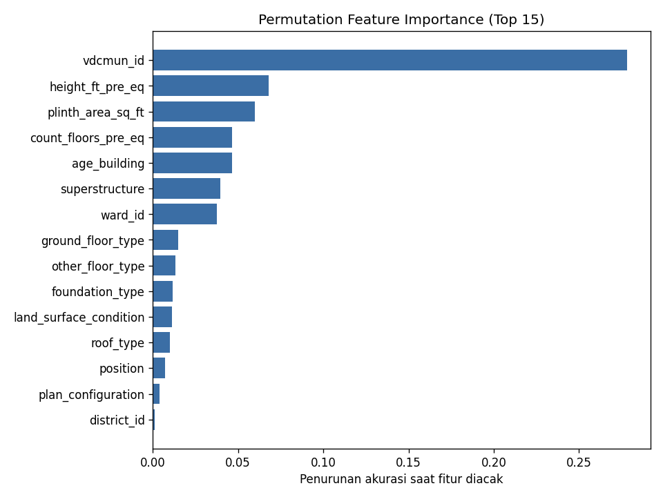
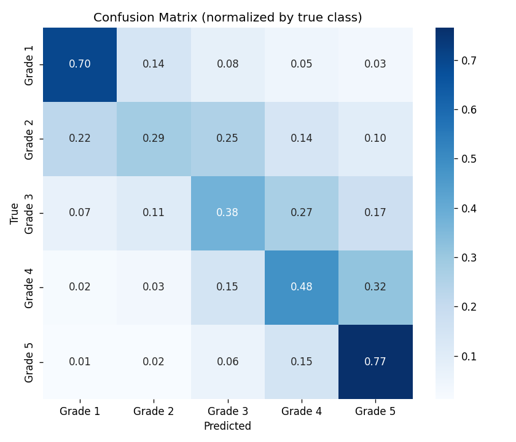

# Richter's Predictor — Nepal Earthquake Damage Prediction

Kompetisi Kaggle: [Richter's Predictor: Modeling Earthquake Damage](https://www.kaggle.com/competitions/richter-predictor)

## Deskripsi Masalah
Memprediksi tingkat kerusakan bangunan (`damage_grade`: Grade 1–5) setelah gempa Gorkha 2015 di Nepal, berdasarkan fitur struktur, material, dan lokasi bangunan. Metrik evaluasi: **micro-averaged F1**.

## Pendekatan
- **Model**: `HistGradientBoostingClassifier` (scikit-learn) — *bukan* Neural Network.
- **Pipeline tunggal** (`scripts/train.py::build_pipeline`):
  `BuildingFeatureEngineer` → `ColumnTransformer` (OrdinalEncoder untuk kategorikal) → model.
  Pipeline yang sama dipakai untuk preprocessing, cross-validation, tuning, dan prediksi, sehingga tidak ada kebocoran data.
- **Feature engineering**: penanganan `age_building = 999` (umur tidak diketahui → `NaN` + flag `age_unknown`), tinggi/luas per lantai, rasio tinggi-luas, umur × lantai.
- **Fitur geografis**: `district_id` & `vdcmun_id` sebagai kategori native, `ward_id` sebagai numerik.

## Struktur Repository
```
richter-predictor/
├── README.md
├── .gitignore
├── requirements.txt
├── data/                  # dataset (tidak di-commit, lihat bagian "Unduh Data")
│   └── metadata.csv       # deskripsi variabel (kecil, ikut di-commit)
├── notebooks/
│   ├── 01_eda.ipynb
│   ├── 02_modeling.ipynb
│   └── 03_submission.ipynb
├── scripts/
│   ├── __init__.py
│   ├── config.py               # path & konstanta
│   ├── preprocess.py           # loader data + ColumnTransformer
│   ├── feature_engineering.py  # transformer fitur turunan
│   ├── train.py                # pipeline, CV, fit final, simpan model
│   ├── tune.py                 # RandomizedSearchCV di atas pipeline
│   ├── predict.py              # prediksi + validasi submission
│   └── evaluate.py             # metrik & gambar
├── models/
│   └── pipeline_model_hgb.pkl
├── submissions/
│   └── submission.csv
└── reports/
    ├── metrics.json
    └── figures/
```

## Unduh Data
Dataset **tidak di-commit** (dikecualikan lewat `.gitignore`). Unduh dari halaman kompetisi lalu letakkan di folder `data/`:

**Opsi 1 — Kaggle CLI**
```bash
pip install kaggle                      # simpan API token di ~/.kaggle/kaggle.json
kaggle competitions download -c richter-predictor -p data/
unzip data/richter-predictor.zip -d data/
```

**Opsi 2 — Manual**: buka halaman kompetisi → tab *Data* → *Download All* → ekstrak ke `data/`.

Setelah itu `data/` harus berisi: `train.csv`, `test.csv`, `sample_submission.csv`, `metadata.csv`.

## Cara Menjalankan
Jalankan semua perintah dari **root repository**.

```bash
python -m venv venv && source venv/bin/activate      # Windows: venv\Scripts\activate
pip install -r requirements.txt

python -m scripts.train                  # CV + fit final -> models/pipeline_model_hgb.pkl
python -m scripts.predict                # -> submissions/submission.csv

# opsional: tuning lalu training ulang dengan parameter terbaik
python -m scripts.tune --n-iter 10 --sample 100000
python -m scripts.train --params models/best_params.json
```

Notebook dijalankan dari folder `notebooks/` (`jupyter notebook`).

## Hasil
Lihat `reports/metrics.json` untuk skor cross-validation terbaru dan `reports/figures/` untuk confusion matrix serta feature importance.

| Metrik (3-fold Stratified CV, OOF) | Nilai |
|---|---|
| Micro-F1 (= accuracy) | **0.5655** (± 0.0020) |
| Baseline kelas mayoritas | 0.3614 |

Catatan: model berhenti di batas `max_iter=400` (belum konvergen penuh), jadi menaikkan `max_iter` dan/atau menjalankan `scripts.tune` masih berpotensi meningkatkan skor.




## Aturan Proyek
- Dataset besar (>100MB) tidak di-commit; `data/*.csv` ada di `.gitignore`.
- Preprocessing, training, dan tuning menggunakan `Pipeline`.
- Setiap function/class di file `.py` memiliki docstring.
- Tidak menggunakan model Neural Network.
